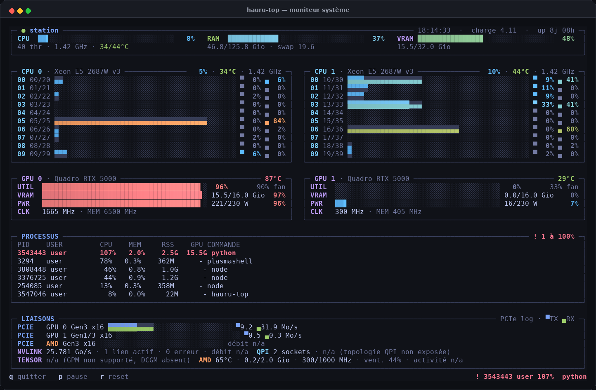

# hauru-top

Tableau de bord système pour le terminal Linux : charge CPU par cœur physique,
mémoire, GPU NVIDIA, processus, capteurs, historique et interconnexions — le
tout dans une interface couleur adaptative, avec un binaire natif en Rust.



> Capture d’exemple anonymisée avec `--privacy` ; le nom affiché est
> personnalisable avec `--title`.

## Fonctionnalités

- Charge CPU **par socket, par cœur physique**, avec les threads SMT
  empilés dans une barre unique (moitié haute / moitié basse).
- Nombre de sockets, de cœurs et de threads découvert automatiquement dans
  `/sys` : aucun matériel n'est codé en dur.
- RAM, swap, charge système (load average), uptime, fréquences et températures
  par socket.
- GPU NVIDIA découverts dynamiquement : utilisation, VRAM, puissance,
  température, ventilateur et horloges.
- Panneau **LIAISONS** : débits PCIe TX/RX par lien via NVML, état et vitesse
  NVLink, topologie QPI/UPI, activité tensor si disponible, capteurs AMD/amdgpu.
- Panneau **PROCESSUS** : top CPU/RAM/GPU avec PID, utilisateur, CPU %, mémoire,
  RSS, VRAM et ligne de commande. Les processus à 100 % d'un cœur sont en rouge
  et rappelés dans le pied de page.
- Historique sparkline pour CPU, GPU, RAM et VRAM ; alerte rouge dès qu'un
  thread atteint la saturation.
- Couleurs 24 bits, 256 couleurs ou 16 couleurs ; `NO_COLOR` respecté ; mode
  `--ascii` complet.
- Interface adaptative : panneau de liaisons et historique ajustés selon la
  hauteur, largeur minimale de 76 colonnes.
- Aucun privilège root nécessaire ; terminal restauré sur `q`, `Ctrl+C`,
  SIGTERM et SIGHUP.
- Nom affiché dans l'en-tête configurable avec `--title` (nom d'hôte par
  défaut) et mode `--privacy` pour masquer les utilisateurs et les arguments de
  commande (utile pour les captures).

## Installation

### Binaire précompilé

Téléchargez l'archive de la [dernière release](https://github.com/stephanedenis/hauru-top/releases)
(`x86_64-unknown-linux-gnu`), puis :

```bash
tar -xzf hauru-top-1.3.0-x86_64-unknown-linux-gnu.tar.gz
sudo install -m 755 hauru-top /usr/local/bin/
hauru-top --version
```

### Depuis les sources

Prérequis : Rust stable et Linux. Le projet est un binaire unique.

```bash
git clone https://github.com/stephanedenis/hauru-top.git
cd hauru-top
cargo build --release
./target/release/hauru-top
```

Ou pour l'installer dans le `PATH` de Cargo :

```bash
cargo install --path .
```

## Utilisation

```bash
hauru-top                         # 1 Hz, plein écran
hauru-top -i 0.5                  # deux rafraîchissements par seconde
hauru-top --once                  # une image, puis sortie
hauru-top --once --width 140 --height 40 > vue.txt
hauru-top --color always
hauru-top --ascii
hauru-top --title "mon-serveur"
```

| Option | Description |
| --- | --- |
| `-i`, `--interval <secondes>` | Période d'échantillonnage (0,2 à 30 s) |
| `--once` | Affiche une seule image et quitte |
| `--width`, `--height` | Force les dimensions (utile avec `--once`) |
| `--color auto\|always\|never` | Mode couleur |
| `--ascii` | Bordures, barres et sparklines en ASCII |
| `--title <nom>` | Nom affiché dans l'en-tête (nom d'hôte par défaut) |
| `--privacy` | Masque les noms d'utilisateur et les arguments de commande |
| `-h`, `--help` | Aide |
| `--version` | Version |

| Touche | Effet |
| --- | --- |
| `q` | Quitter |
| `p` / `Espace` | Figer ou reprendre les mesures |
| `r` | Vider l'historique |
| `Ctrl+C` | Quitter proprement |

## Sources de données

| Donnée | Source |
| --- | --- |
| Charge par thread | delta de `/proc/stat` |
| Sockets, cœurs, threads SMT | `/sys/devices/system/cpu/*/topology/` |
| Fréquences | `cpufreq/scaling_cur_freq` |
| Températures CPU | `hwmon/coretemp` et capteurs disponibles |
| RAM / swap | `/proc/meminfo` |
| Load average / uptime | `getloadavg` / `/proc/uptime` |
| GPU NVIDIA | `nvidia-smi` (appel borné dans le temps) |
| PCIe, NVLink, tensor | NVML et `nvidia-smi` |
| AMD | `amdgpu`/sysfs : capteurs exposés par le pilote |

Le nombre de sockets, de GPU et de capteurs est variable. Les éléments absents
sont simplement indiqués `n/a`, sans interrompre le tableau de bord.

Les pourcentages CPU des processus suivent la convention « un cœur = 100 % » :
un processus multi-thread peut donc dépasser 100 % (par exemple 400 % pour
quatre cœurs saturés). Les processus à 100 % ou plus sont mis en évidence en
rouge.

## Rendu et adaptation

- Les sockets détectés sont côte à côte (un seul socket occupe toute la
  largeur) ; chaque cœur physique occupe une ligne avec une barre dont la
  moitié haute suit le premier thread SMT et la moitié basse le second.
- Le panneau LIAISONS apparaît sur les écrans assez hauts ; l'historique prend
  le relais ou se réduit selon la place disponible.
- Taille minimale : 76 × 22. En dessous, un message indique la taille requise
  et `q` reste actif.
- Le panneau PROCESSUS apparaît à partir de 33 lignes ; en dessous, une alerte
  de saturation (PID, utilisateur, CPU, commande) reste affichée dans le pied
  de page. `--privacy` s'applique aussi à cette alerte.
- Les barres PCIe utilisent une échelle logarithmique (1 Mo/s à 10 Go/s) et
  affichent les débits exacts ; il ne s'agit pas d'un pourcentage de capacité.
- Le thème est prévu pour un fond sombre ; `NO_COLOR` et `--color never`
  désactivent les couleurs.

## Limites connues

- Linux uniquement (lecture de `/proc` et `/sys`, `nvidia-smi`, NVML).
- L'interface est optimisée pour une ou deux sockets CPU et jusqu'à deux GPU
  NVIDIA ; les cartes supplémentaires sont détectées mais ne disposent pas
  encore d'une carte dédiée.
- Les capteurs dépendent du matériel et du pilote : certains GPU, cartes AMD ou
  CPU n'exposent pas toutes les mesures. L'interface affiche `n/a` le cas
  échéant.
- La topologie QPI/UPI n'est pas exposée de façon portable par le noyau ;
  `hauru-top` affiche les sockets et indique que le détail n'est pas disponible.
- Le débit QPI et l'activité tensor nécessitent des privilèges supplémentaires
  (perf/CAP_PERFMON) ou des bibliothèques constructeur ; ces mesures restent
  optionnelles.
- L'historique est en mémoire (environ 10 minutes à 1 Hz) et repart à zéro au
  lancement.
- `nvidia-smi` est relancé à chaque cycle ; en cas de blocage, l'appel est coupé
  et l'erreur est affichée sans arrêter l'interface.

## Développement

```bash
cargo fmt --check
cargo clippy --all-targets
cargo test
cargo build --release
```

Le code est organisé en trois modules : `sys` (collecte `/proc`, `/sys`,
`nvidia-smi`, NVML), `model` (structures de données) et `ui` (rendu ANSI).

### Ancienne implémentation Python

Une version Python antérieure est conservée dans
[`legacy/python/`](legacy/python/) à titre de référence. **La version active et
maintenue est l'implémentation Rust de ce dépôt.**

## Licence

MIT — voir [LICENSE](LICENSE). Copyright (c) 2026 Stéphane Denis.

Utilisation, modification et redistribution libres, y compris commercialement,
avec conservation de la mention de copyright et du texte de la licence.
